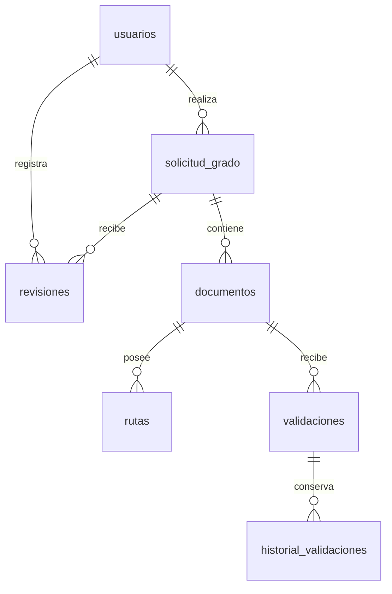
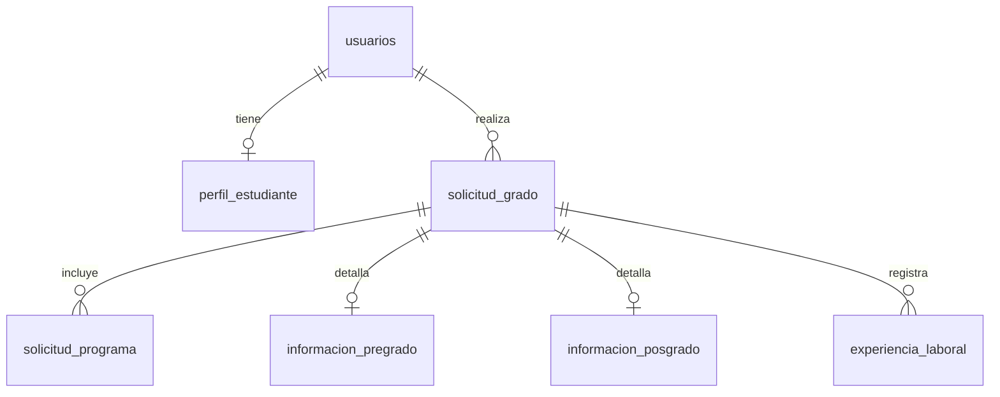

# Base de datos de CheckU

Esquema PostgreSQL para preinscripciones de grado de **pregrado y posgrado**.
Esta entrega corresponde a la **parte 2: información del formulario**. Parte del
modelo de siete tablas del equipo y agrega cinco entidades, para un total de doce.

## Archivos

```text
db/
  init/
    01-schema.sql
    02-userbase.sql
  tests/
    aceptacion.sql
    verificar.ps1
    resultado_verificacion.txt
  README.md
```

- `01-schema.sql`: tablas, restricciones, índices y triggers.
- `02-userbase.sql`: únicamente los dos usuarios indicados por el equipo.
- `tests/aceptacion.sql`: comprueba datos y rechazos esperados; revierte sus cambios.
- `tests/verificar.ps1`: ejecuta esquema, seed y pruebas dos veces con `psql`.
- `tests/resultado_verificacion.txt`: registro de la verificación ejecutada.

## Instalación y alcance de la reescritura

Requiere **PostgreSQL 14 o superior** por `CREATE OR REPLACE TRIGGER`.
La base debe existir antes de ejecutar los scripts. En el proyecto la crea
Compose mediante `POSTGRES_DB`; estos scripts no crean bases ni eliminan datos.

Esta es la reescritura inicial permitida en la tarea, para inicializar una base
sin datos reales. **No es una migración automática desde la versión antigua de
siete tablas**: `CREATE TABLE IF NOT EXISTS` no modifica una tabla existente.
La preparación de una base limpia de laboratorio se hace por separado, según
el procedimiento del equipo; estos archivos no borran tablas ni volúmenes.
Después de esta entrega, los cambios deben ir en archivos nuevos e idempotentes
`03-*.sql` en adelante, sin reescribir el historial de despliegue.

Desde la carpeta raíz del repositorio, con `psql` disponible:

```powershell
psql -h localhost -p 5432 -U postgres -d checku -X -v ON_ERROR_STOP=1 -f db/init/01-schema.sql
psql -h localhost -p 5432 -U postgres -d checku -X -v ON_ERROR_STOP=1 -f db/init/02-userbase.sql
```

Ajusta host, puerto, usuario y base al entorno de tu equipo. Las credenciales
se proporcionan por los mecanismos de conexión del entorno; no se guardan en
las tablas ni se incluyen en esta entrega.

## Tablas

| Tabla | Función y relación |
|---|---|
| `usuarios` | Usuarios y roles `ESTUDIANTE`, `FUNCIONARIO`, `BIBLIOTECA`. Agrega `codigo_estudiante` único, obligatorio para estudiantes. |
| `solicitud_grado` | Solicitud de un usuario, nivel `PREGRADO` o `POSGRADO`, estado y auditoría. |
| `documentos` | Metadatos y versiones de los archivos de una solicitud. |
| `rutas` | Ubicaciones de los archivos en el servidor. |
| `validaciones` | Validaciones documentales y sus resultados. |
| `historial_validaciones` | Estados anteriores y nuevos de las validaciones. |
| `revisiones` | Resultados y comentarios de revisión del funcionario. |
| `perfil_estudiante` | Nueva. Identificación, contacto y residencia. Relación 1:1 opcional con `usuarios`, mediante `id_usuario` como PK y FK. |
| `solicitud_programa` | Nueva. Programa, modalidad, opción de grado y orden 1 o 2 por solicitud. |
| `informacion_pregrado` | Nueva. Saber Pro y vinculación con la UTB. `id_solicitud` es PK y FK. |
| `informacion_posgrado` | Nueva. Estudios, título y condición de egresado. `id_solicitud` es PK y FK. |
| `experiencia_laboral` | Nueva. Hasta dos cargos por solicitud de posgrado, con orden 1 o 2. |

Las siete entidades originales conservan sus columnas funcionales, estados y
relaciones. Sus fechas de auditoría pasan a `TIMESTAMPTZ`. No se agregan datos
extraídos por OCR, credenciales ni nuevos estados a `documentos`, `validaciones`
o `revisiones` en esta tarea.

## Mapeo completo del formulario

**A** = ambos niveles; **P** = pregrado; **G** = posgrado.

| Campo del formulario | Nivel | Tabla y columna | Tipo y condición |
|---|:---:|---|---|
| Correo electrónico | A | `usuarios.correo` | `VARCHAR(150)`, obligatorio y único. |
| Nombres | A | `usuarios.nombres` | `VARCHAR(100)`, obligatorio. |
| Apellidos | A | `usuarios.apellidos` | `VARCHAR(100)`, obligatorio. |
| Código estudiantil | A | `usuarios.codigo_estudiante` | `TEXT`, único; no nulo ni vacío para estudiantes. |
| Tipo de documento | A | `perfil_estudiante.tipo_documento_identidad` | `TEXT`, obligatorio, sin catálogo cerrado. |
| Número de documento | A | `perfil_estudiante.numero_documento` | `TEXT`, obligatorio; solo letras ASCII y dígitos; único junto con el tipo. |
| Fecha de nacimiento | A | `perfil_estudiante.fecha_nacimiento` | `DATE`, permite nulo. |
| Género | A | `perfil_estudiante.genero` | `TEXT`, permite nulo; catálogo pendiente. |
| Departamento de residencia | A | `perfil_estudiante.departamento_residencia` | `TEXT`, permite nulo. |
| Ciudad o municipio de residencia | A | `perfil_estudiante.ciudad_residencia` | `TEXT`, permite nulo. |
| Dirección de residencia | A | `perfil_estudiante.direccion_residencia` | `TEXT`, permite nulo. |
| Teléfono fijo | A | `perfil_estudiante.telefono_fijo` | `TEXT`, opcional. |
| Teléfono celular | A | `perfil_estudiante.telefono_celular` | `TEXT`, permite nulo hasta confirmar obligatoriedad. |
| Programa principal | A | `solicitud_programa.programa`, `orden=1` | `TEXT`, obligatorio y no vacío en la fila. |
| Modalidad | A | `solicitud_programa.modalidad` | `VARCHAR(20)`, `VIRTUAL` o `PRESENCIAL`, obligatoria. |
| Tipo de opción de grado | P | `solicitud_programa.tipo_opcion_grado` | `TEXT`, catálogo pendiente; siempre nulo en posgrado. |
| Segundo programa, modalidad y opción | A | Otra fila de `solicitud_programa`, `orden=2` | Opcional; mismas columnas que la fila principal. |
| ¿Conoce el registro Saber Pro? | P | `informacion_pregrado.conoce_registro_saber_pro` | `BOOLEAN`, permite nulo si no responde. |
| Número de registro Saber Pro | P | `informacion_pregrado.numero_registro_saber_pro` | `TEXT`, requerido y no vacío si conoce el registro; nulo en otro caso. |
| Fecha del examen Saber Pro | P | `informacion_pregrado.fecha_examen_saber_pro` | `DATE`, permite nulo. |
| ¿Es empleado de la UTB? | P | `informacion_pregrado.es_empleado_utb` | `BOOLEAN`, permite nulo. |
| Tipo de contrato | P | `informacion_pregrado.tipo_contrato` | `TEXT`, solo puede tener valor si es empleado; catálogo pendiente. |
| ¿Es hijo de empleado de la UTB? | P | `informacion_pregrado.es_hijo_empleado_utb` | `BOOLEAN`, permite nulo. |
| Nivel de estudios alcanzado | G | `informacion_posgrado.nivel_estudios_alcanzado` | `TEXT`, permite nulo; catálogo pendiente. |
| Título obtenido | G | `informacion_posgrado.titulo_obtenido` | `TEXT`, permite nulo. |
| ¿Es egresado de pregrado de la UTB? | G | `informacion_posgrado.es_egresado_pregrado_utb` | `BOOLEAN`, permite nulo. |
| Empresa de cada cargo | G | `experiencia_laboral.empresa` | `TEXT`, filas con orden 1 y 2; permite nulo. |
| Cargo desempeñado | G | `experiencia_laboral.cargo` | `TEXT`, permite nulo. |
| Tiempo en el cargo | G | `experiencia_laboral.tiempo` | `TEXT`, por ejemplo `2 años`; sin conversión a fecha o número. |
| Hora de última modificación | A | `solicitud_grado.fecha_actualizacion` | `TIMESTAMPTZ`, actualizada mediante trigger. |

Los datos estables se guardan en el perfil. Lo que cambia por trámite se guarda
en la solicitud y sus tablas hijas. La obligatoriedad es por fila: el esquema
permite solicitudes en `BORRADOR` sin haber creado aún todas las filas hijas.
La comprobación de formulario completo al enviarlo pertenece al flujo de aplicación.

No se duplican la confirmación de correo, el correo repetido ni el campo
"Nombre" que repite nombres y apellidos. Los adjuntos de posgrado pertenecen a
`documentos` y `rutas`, no a columnas adicionales en `informacion_posgrado`.

## Restricciones e integridad

- `chk_usuarios_estudiante_con_codigo`: todo estudiante tiene código no nulo y no vacío.
- `uq_usuarios_codigo_estudiante`: los códigos no nulos son únicos; los otros roles
  pueden tener código nulo.
- `chk_perfil_numero_documento`: rechaza puntos, comas, espacios, tabulaciones y
  otros caracteres distintos de `A-Z`, `a-z`, `0-9`.
- `uq_perfil_estudiante_identidad`: identidad única por tipo y número.
- `chk_registro_saber_pro`: un registro no vacío requiere que la respuesta sea
  verdadera; si la respuesta es falsa o nula, el número debe ser nulo.
- `chk_tipo_contrato_empleado`: no permite contrato si no es empleado. Ser empleado
  no obliga a responder el tipo de contrato, porque su obligatoriedad no está confirmada.
- `chk_solicitud_programa_orden` y `uq_solicitud_programa_orden`: dos posiciones
  disponibles y sin repetir orden dentro de una misma solicitud.
- `chk_experiencia_laboral_orden` y `uq_experiencia_laboral_orden`: igual límite
  para cargos, sin restringir que dos cargos puedan tener textos iguales.
- Los triggers de nivel impiden datos de pregrado en solicitudes de posgrado,
  datos/cargos de posgrado en solicitudes de pregrado y opción de grado en posgrado.
  También impiden cambiar el nivel dejando datos incompatibles.
- Todas las FK usan `ON DELETE RESTRICT`. No se elimina información relacionada
  automáticamente.
- Las PK y restricciones `UNIQUE` de las tablas nuevas crean índices sobre sus
  claves. Todas las tablas hijas nuevas tienen un índice cuyo primer campo es
  `id_solicitud`; no se agregan índices equivalentes redundantes.
- Las doce tablas utilizan fechas de auditoría con zona horaria. Nacimiento y
  examen usan `DATE`. El trigger de actualización se extiende a las cinco tablas nuevas.

El perfil referencia `usuarios`, pero no se añadió una regla que compruebe su rol;
ese control sigue perteneciendo a la aplicación. Tampoco se cambió la revisión
por funcionario del modelo original ni se automatizó el historial de validaciones.

## Idempotencia

El esquema usa `CREATE TABLE IF NOT EXISTS`, `CREATE INDEX IF NOT EXISTS` y
`CREATE OR REPLACE` en funciones y triggers. Cada archivo tiene una transacción.
El seed utiliza `INSERT ... ON CONFLICT DO NOTHING` en todas sus inserciones.

Los usuarios se identifican por correo; no se escriben IDs a mano. Repetir el
seed conserva las filas existentes mediante `ON CONFLICT (correo) DO NOTHING`.
No crea perfiles, solicitudes, programas, resultados Saber Pro ni experiencia
laboral. Los contadores de identidad pueden avanzar al intentar inserciones con
conflicto; esto es normal y no representa duplicación de usuarios.

## Usuarios iniciales

Se conserva únicamente la lista proporcionada por el equipo:

| Nombre | Correo | Rol | Código estudiantil |
|---|---|---|---|
| Lisandro Zapata | `lizapata@utb.edu.co` | `ESTUDIANTE` | `T00000001` |
| Rosa Marriaga | `rmarriaga@utb.edu.co` | `FUNCIONARIO` | Nulo |

El código de Lisandro es el valor indicado por el usuario para esta configuración.
No se inventan datos de identificación, contacto, programas o historial académico
para estas personas. Las pruebas de restricciones usan datos de laboratorio
solamente dentro de una transacción que se revierte; no agregan usuarios
persistentes ni dejan solicitudes de ejemplo.

Si ya ejecutaste el paquete anterior, cambiar el seed **no elimina** los usuarios
de ejemplo que existan en ese volumen. Esta entrega no hace limpieza automática.
Comprueba el contenido de tu base antes de aplicarla en un entorno existente.

## Diagramas de relaciones

### Núcleo documental existente



### Ampliación del formulario



Las relaciones 1:N de programas y cargos están limitadas a **dos filas** por
las restricciones de orden y unicidad. Las dos tablas de información académica
no se utilizan simultáneamente para una misma solicitud.

## Pruebas reproducibles con psql

En una base limpia de laboratorio, desde la raíz del repositorio:

```powershell
./db/tests/verificar.ps1 -Servidor localhost -Puerto 5432 -Usuario postgres -BaseDatos checku
```

El script no borra ni prepara la base: requiere un entorno de prueba apropiado.
Ejecuta los dos archivos dos veces sobre la misma base y después de cada pasada
comprueba que solo estén los dos usuarios y verifica las restricciones. Cada invocación utiliza
`-X -v ON_ERROR_STOP=1`; cualquier error inesperado detiene la ejecución.

Las pruebas cubren inicialización con solo Lisandro y Rosa, conteos, identidad sin separadores,
código estudiantil obligatorio y único, registro Saber Pro condicional,
contrato condicional, límite de programas/cargos, modalidad, nivel de solicitud,
FK restrictivas y tipos/actualización de auditoría. Sus modificaciones se
revierten con `ROLLBACK`; los errores esperados se capturan dentro de PL/pgSQL.

## Verificado y pendiente

**Verificado ejecutando:** las dos pasadas con `psql` terminaron sin errores
inesperados, se crearon las doce tablas, las restricciones de aceptación
respondieron correctamente y la comparación de todas las filas confirmó que
la segunda ejecución no duplicó ni cambió los datos.

Entorno de la verificación: cliente **psql 16.15**, conectado por TCP a
**PostgreSQL 18.6 compilado en WebAssembly mediante PGlite 0.5.11**. Fue una base
limpia y aislada de prueba, no el servidor ni el volumen del proyecto. El log
adjunto conserva las salidas de ambas pasadas. No se hicieron pruebas de
concurrencia ni de despliegue nativo con Docker/Compose. El archivo PowerShell
se entrega para reproducir la verificación en Windows; no se ejecutó aquí,
porque el entorno de prueba es Linux. Las invocaciones a psql sí se ejecutaron.

**Pendiente del equipo:**

1. Repetir la verificación en su servicio PostgreSQL de Compose, con su versión real.
2. Confirmar catálogos de documento, género, opción de grado, contrato y nivel de estudios.
3. Confirmar los formatos del código estudiantil y del registro Saber Pro. Los
   ejemplos usan `T` más 8 dígitos y `EK` más 12 dígitos; no se imponen aún como regex.
4. Confirmar si el correo del formulario coincide con el de la cuenta. Por ahora
   solo existe `usuarios.correo`.
5. Confirmar si debe existir una solicitud activa por estudiante. No se impone
   una restricción única sobre `solicitud_grado.id_estudiante`.
6. Confirmar obligatoriedad real de los campos actualmente opcionales y las
   políticas de acceso y retención de datos personales.


## Contexto del despliegue existente

Según el README anterior del equipo, `db/` es el contexto de construcción del
servicio `db` de Compose. La inicialización en `/docker-entrypoint-initdb.d/`
se ejecuta cuando el volumen de datos está vacío; el servicio `db-migrate`,
si está configurado, vuelve a aplicar los SQL en cada despliegue. Estas
instrucciones de despliegue no se verificaron contra los archivos Compose,
porque no se suministraron en esta tarea.

| Variable | Uso documentado por el equipo |
|---|---|
| `DB_USER`, `DB_PASSWORD`, `DB_NAME` | Conexión y nombre de base definidos en el entorno. |
| `DB_HOST` | `db` en Docker; `localhost` al ejecutar el backend desde el equipo. |
| `DB_PORT` | Puerto de PostgreSQL; el README anterior indica `5432`. |
| `DEV_SHARED_PASSWORD` | Clave común temporal del login de pruebas, fuera de las tablas y los SQL. |
| `CHECKU_REF` | Referencia de código empleada para construir la carpeta `db/`. |

El equipo documenta `.env` local y Dokploy Environment en servidor; no se
incluyen valores de claves en este paquete. Conserva los archivos Compose,
la configuración de Dokploy y el mecanismo de autenticación existente.
No se abre el puerto de base de datos al público como parte de esta entrega.
El volumen conserva sus datos y cambiar los SQL no lo reinicializa.

Para un respaldo desde Docker, el equipo puede usar `pg_dump -f` y copiar el
archivo fuera del contenedor, evitando depender de la redirección de texto de
PowerShell. Antes de cambiar una versión mayor o hacer una operación destructiva,
utiliza el procedimiento de respaldo/restauración del equipo. No se entrega
ningún comando que borre el volumen o los usuarios existentes.

## Fuera de alcance

Endpoints, ORM, migraciones de la tarea 03, lectura desde la pantalla "Mi
información", el flujo de entregas/reenvíos y cambios funcionales en
`documentos`, `validaciones` y `revisiones`. El límite del esquema no equivale
a una implementación del frontend o del backend.

## Referencias técnicas

- PostgreSQL 14, CREATE TRIGGER: https://www.postgresql.org/docs/14/sql-createtrigger.html
- PGlite Socket, conexión mediante psql: https://pglite.dev/docs/pglite-socket


## Periodos de grado (dashboard del funcionario)

Cada registro contiene nombre, fecha de apertura/cierre de recepción, fecha de graduación y estado.
`ABIERTO` indica que el periodo acepta solicitudes; `CERRADO` indica que no debe aceptar nuevas solicitudes.

Bajo el prefijo `/api`, el backend NestJS expone:

- `GET /periodos-grado`: consulta todos los periodos para el selector y la administración.
- `GET /periodos-grado?estado=ABIERTO`: consulta solo los periodos abiertos.
- `GET /periodos-grado?estado=CERRADO`: consulta solo los periodos cerrados.
- `POST /periodos-grado`: registra un periodo.
- `PATCH /periodos-grado/:id`: actualiza un periodo existente, incluido su estado.

El cuerpo de creación/edición usa `nombre`, `fechaInicio`, `fechaFin`, `fechaGraduacion` y `estado`.
`estado` acepta únicamente `ABIERTO` o `CERRADO` y, si se omite en la creación, queda `ABIERTO`.
Las operaciones requieren una sesión autenticada de funcionario.

**Limitación conocida:** el repositorio todavía no contiene una entidad ni endpoints reales para solicitudes de grado. Por ello el dashboard sigue utilizando datos de demostración; el listado de solicitudes todavía no se relaciona por clave foránea con `periodos_grado`. Antes de aceptar solicitudes reales, el endpoint que las cree deberá validar que el periodo esté `ABIERTO` y dentro de las fechas permitidas, y guardar `periodo_id` en la solicitud. El estado por sí solo no bloquea solicitudes hasta que esa validación se implemente en el flujo de creación de solicitudes.
